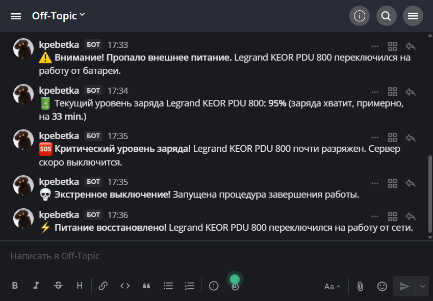

Волею судеб, с 2020-го года я являюсь обладателем UPS [Legrand Keor PDU 800](https://ups.legrand.com/en/products/keor-pdu), который изначально приобретался как максимально простое и дешёвое решение для резервного питания сетевого оборудования, главная цель которого - возможность пережить кратковременное отключение электроэнергии в квартире, чтобы я мог спокойно продолжать работать работу за ноутбуком. И вроде бы всё хорошо, но со временем меня стали одолевать мысли о том, что, иногда, когда моё бренное тело не находилось в квартире, хотелось бы узнавать о том что электричества нет продолжительное время и пора предпринимать меры по скорейшему возвращению домой, дабы, например, решить вопрос с размораживающимися продуктами в холодильнике. Но подобные мои мечты были тщетны и разбивались о то, что, фактически, поддержка данного устройства в [Network UPS Tools](https://github.com/networkupstools/nut) отсутствовала, а любые попытки получить что-то работоспособное из веток и фекалий заканчивались провалом... Благо 26 апреля 2022 года в [релизе NUT `(Network UPS Tools)` версии 2.8.0](https://github.com/networkupstools/nut/compare/v2.7.4...v2.8.0) появилась нативная поддержка UPS `Legrand Keor PDU`, которая внушила некоторые надежды на успех и послужила толчком для повторения попыток раскрыть в чуть большей степени «потенцивал» сего чудесного устройства.

Итого, на момент релиза `NUT 2.8.0`, от данного UPS запитывается NAS [QNAP TS-451DeU](https://www.qnap.com/en/product/ts-451deu), сетевое оборудование, в частности [MikroTik RB4011iGS+5HacQ2HnD](https://mikrotik.com/product/rb4011igs_5hacq2hnd_in), [MikroTik CSS326-24G-2S+RM](https://mikrotik.com/product/CSS326-24G-2SplusRM), и `Jump-хост` (для доступа на ранее обозначенные NAS и сетевое оборудование), который являет собой `Raspberry Pi Zero` с [Waveshare PoE Ethernet / USB HUB HAT](https://www.waveshare.com/poe-eth-usb-hub-hat.htm) - именно этот `Jump` решено использовать как устройство отслеживающее состояние UPS со всеми вытекающими из этого отслеживания возможными действиями, а именно отправкой уведомлений о состоянии UPS в `Mattermost` *(почему не [QNAP TS-451DeU](https://www.qnap.com/en/product/ts-451deu), возможно, расскажу когда-нибудь потом... А может и нет...)*.

На моём `Raspberry Pi Zero` установлена `Raspbery Pi OS` *(удивительно, но факт)*, которая являет собой `Debian`, а это значит, что пакет `NUT` нужной нам версии `2.8.0+` в официальном репозитории мы увидим чуть раньше чем никогда, и отсюда следует, что нам придётся самостоятельно собрать нужный нам «расово верный» `NUT`.

### Сборка и установка Network UPS Tools

Перед тем как приступить к сборке нам необходимо установить базовый набор инструментов и библиотек, без которых сборку не получится осуществить. Для этого в терминале выполняем пару команд:
```bash
sudo apt-get update
sudo apt-get install -y \
    autoconf automake libtool libtool-bin \
    git python3-dev python3-pip \
    libltdl-dev gettext \
    libcppunit-dev libssl-dev libnss3-dev \
    libusb-dev libusb-1.0-0-dev \
    libsnmp-dev libneon27-dev \
    libi2c-dev i2c-tools lm-sensors \
    libmodbus-dev libpowerman0-dev libfreeipmi-dev libipmimonitoring-dev \
    libavahi-common-dev libavahi-core-dev libavahi-client-dev \
    libgd-dev libsystemd-dev
```

После чего нам необходимо склонировать репозиторий с указанием тега `v2.8.0`, чтобы сэкономить место и время:
```bash
git clone --branch v2.8.0 --depth 1 https://github.com/networkupstools/nut.git && cd nut
```

Затем необходимо сгенерировать скрипт `configure` и прочие файлы сборки:
```bash
./autogen.sh
```

После успешного завершения генерации, мы приступаем к ключевому шагу - конфигурированию сборки `NUT` таким образом, чтобы  она использовала пути к конфигам и драйверам аналогичные тем которые используются в пакете из официального репозитория и гарантировано работающей интеграцией с `systemd`:
```bash
./configure --prefix=/usr \
            --includedir=/usr/include \
            --mandir=/usr/share/man \
            --infodir=/usr/share/info \
            --sysconfdir=/etc/nut \
            --localstatedir=/var \
            --libexecdir=/usr/lib/nut \
            --srcdir=. \
            --enable-maintainer-mode \
            --disable-silent-rules \
            --libdir=/usr/lib/`gcc -print-multiarch` \
            --with-ssl \
            --with-nss \
            --with-cgi \
            --with-dev \
            --enable-static \
            --with-statepath=/var/run/nut \
            --with-altpidpath=/var/run/nut \
            --with-drvpath=/lib/nut \
            --with-cgipath=/usr/lib/cgi-bin/nut \
            --with-htmlpath=/usr/share/nut/www \
            --with-pidpath=/var/run/nut \
            --datadir=/usr/share/nut \
            --with-pkgconfig-dir=/usr/lib/`gcc -print-multiarch`/pkgconfig \
            --with-systemdsystemunitdir=/lib/systemd/system
```

После завершения процесса конфигурации запускаем сборку и установку собранного:
```bash
make
sudo make install
```

Как только сборка и установка завершится, можно убедиться что ключевые компоненты установлены и они нужной нам версии:
```bash
upsc -V
/lib/nut/usbhid-ups -V
```
*В выводе должна отображаться версия `2.8.0`.*

После чего мы можем удалить всё лишнее, что нам было необходимо для сборки и более не нужно после успешного окончания оной:
```bash
sudo apt purge \
    autoconf automake libtool libtool-bin \
    git python3-dev python3-pip \
    libltdl-dev gettext \
    libcppunit-dev libssl-dev libnss3-dev \
    libusb-dev libusb-1.0-0-dev \
    libsnmp-dev libneon27-dev \
    libi2c-dev i2c-tools lm-sensors \
    libmodbus-dev libpowerman0-dev libfreeipmi-dev libipmimonitoring-dev \
    libavahi-common-dev libavahi-core-dev libavahi-client-dev \
    libgd-dev libsystemd-dev
sudo apt autoremove --purge
```

### Подключение Legrand Keor PDU и настройка Network UPS Tools

Для начала убеждаемся, что система видит ваше устройство по USB - подключаем UPS к `Raspberry Pi Zero` и выполняем:
```bash
lsusb
```
*Если в выводе видим строку, содержащую `1cb0:0038`, то мы на верном пути - это идентификаторы производителя *(`Legrand`)* и продукта *(`Keor PDU 800`)*, которые в дальнейшем нам понадобятся для настройки.*

Следующим шагом мы должны указать режим работы нашего экземпляра `NUT`, для чего создаём конфиг `/etc/nut/nut.conf` путём копирования сэмпла дефолтного конфига:
```bash
sudo cp /etc/nut/nut.conf.sample /etc/nut/nut.conf
```

Открываем его редактором:
```bash
sudo nano /etc/nut/nut.conf
```

Единственное что нам нужно в нём поправить - режим работы на `standalone`:
```conf
MODE=standalone
```

Следующим правим основной файл конфигурации для драйверов, в котором мы «опишем» наше устройство - `/etc/nut/ups.conf`. Аналогично предыдущему создаём нужный нам файл конфигурации из сэмпла дефолтного конфига и открываем файл для редактирования:
```bash
sudo cp /etc/nut/ups.conf.sample /etc/nut/ups.conf
sudo nano /etc/nut/ups.conf
```

Добавляем в конец файла следующую секцию:
```conf
[keor]
    driver = usbhid-ups
    port = auto
    vendorid = 1cb0
    productid = 0038
    pollinterval = 3
    pollfreq = 3
```
*Имя в квадратных скобках (`[keor]`) — это произвольное имя, которое мы будем использовать для обращения к этому UPS в других командах и файлах*

Также добавляем в соответствующую секцию конфига параметры отвечающие за повторные попытки «опроса» устройства, в случае если предыдущая попытка не увенчалась успехом:
```conf
maxretry = 5
retrydelay = 5
```

Наш следующий «пациент» - `/etc/nut/upsmon.conf`. В этом конфиге определяется как система будет отслеживать состояние UPS и реагировать на события *(например, переход на батарею и/или восстановление питания от сети)*. Действуем по аналогии с предыдущими:
```bash
sudo cp /etc/nut/upsmon.conf.sample /etc/nut/upsmon.conf
sudo nano /etc/nut/upsmon.conf
```

Находим директиву `MONITOR`, в которой указывается какой UPS отслеживать, и приводим её к виду такому: 
```conf
MONITOR keor@localhost 1 upsuser upspassword primary
```
*==Здесь upsuser и upspassword указаны в качестве примера - обязательно замените их на свои==, и убедитесь, что они совпадают с теми, что вы укажете в файле `upsd.users`, к редактированию которого мы переходим в следующем абзаце.*

Выше упомянутый файл конфигурации `/etc/nut/upsd.users` определяет пользователей, которые могут подключаться к `upsd` *(серверу `NUT`)*. Он нужен для работы `upsmon` *(в нашем случае без него мы не обойдёмся)*, а также для удалённого управления (эти знания нам пригодятся, если такое нам понадобится в будущем). Аналогично предыдущим файлам конфигурации:
```bash
sudo cp /etc/nut/upsd.users.sample /etc/nut/upsd.users
sudo nano /etc/nut/upsd.users
```

Добавляем пользователя, которого мы указали в `/etc/nut/upsmon.conf`:
```conf
[upsuser]
    password = upspassword
    upsmon primary
```
*Атрибут `primary` даёт право отправлять команды на UPS (в целом это немного избыточно для наших текущих задач, ибо должно хватить и `slave`, но пусть будет `primary` с прицелом на будущее). ==Не забудьте заменить upsuser и upspassword на свои значения== из `/etc/nut/upsmon.conf`.*

Последний в нашем списке, но не по значению, файл конфигурации `/etc/nut/upsd.conf`. Благо в нашем случае его вовсе не нужно править и достаточно взять дефолтный:
```bash
sudo cp /etc/nut/upsd.conf.sample /etc/nut/upsd.conf
```

После того как разобрались с файлами конфигурации `Network UPS Tools`, необходимо обновить конфигурацию `systemd`, а именно сообщить `systemd` о новых юнит-файлах и создать временные каталоги для их корректной работы *(например, `/var/run/nut`)*:
```bash
sudo systemctl daemon-reload
sudo systemd-tmpfiles --create
```

Если предыдущий пункт выполнится успешно, то можем приступать к включению и запуску необходимых служб и тут важно отметить что начиная с версии `2.8.0`, архитектура служб `NUT` использует `nut-driver-enumerator`, который автоматически создаёт службы для каждого драйвера из `ups.conf`, потому нам достаточно включить базовый набор служб:
```bash
sudo systemctl enable nut.target
sudo systemctl enable nut-driver-enumerator.service
sudo systemctl enable nut-driver-enumerator.path
sudo systemctl enable nut-server.service
sudo systemctl enable nut-monitor.service
```

Затем просто запускаем всё дерево служб через запуск единственного `nut.target`:
```bash
sudo systemctl start nut.target
```

Теперь просто убеждаемся, что ключевые компоненты активны, и проверяем, что NDE создал службу для нашего драйвера:
```bash
systemctl status nut-server
systemctl status nut-monitor
systemctl status nut-driver-enumerator
systemctl list-units 'nut-driver@*'
```

Затем проверяем, что драйвер видит наш UPS и успешно получает с него данные:
```bash
upsc keor
```
*Если всё настроено правильно, команда `upsc keor` выведет список параметров, таких как `ups.status` (например, `ONLINE` или `ONBATT`), `battery.charge`, `input.voltage` и многих других, иногда, полезных.*

### Отслеживание статуса UPS

Для получения только «устойчивых» изменений состояний UPS *(например, «UPS на батарее дольше 30 секунд»)* и при этом не городить очередной свой велосипед из веток и фекалий *(этого мы уже успели наделать в достаточном количестве и успеем наделать ещё дольше, но чуть позже)*, мы будем использовать штатный планировщик `NUT` - `upssched`. Он работает как таймерный демон и запускает определённые нами команды только после истечения заданного интервала времени, что гарантирует отсутствие «шторма» мгновенных уведомлений *(например, при кратковременных скачках напряжения)* и настраивается в конфигурационном файле `upssched.conf`

Но, перед тем как настраивать `upssched`, нам нужно донастроить `upsmon`, а именно делегировать обработку событий планировщику `upssched` и включить `EXEC` для событий, которые будут обрабатываться таймерами. Для этого открываем `/etc/nut/upsmon.conf`:
```bash
sudo nano /etc/nut/upsmon.conf
```

И в соответствующих секциях приводим `NOTIFYCMD` и `NOTIFYFLAG` к следующему виду, чтобы `upsmon` вызывал `upssched` при каждом событии с флагом `EXEC`:
```conf
NOTIFYCMD /usr/sbin/upssched

...

NOTIFYFLAG ONLINE   SYSLOG+WALL+EXEC
NOTIFYFLAG ONBATT   SYSLOG+WALL+EXEC
NOTIFYFLAG LOWBATT  SYSLOG+WALL+EXEC
NOTIFYFLAG SHUTDOWN SYSLOG+WALL+EXEC
```

Теперь переходим к самому главному в этом разделе - файлу `/etc/nut/upssched.conf`, который будет управлять логикой таймеров. Создаём его, как мы уже привыкли и открываем:
```bash
sudo cp /etc/nut/upssched.conf.sample /etc/nut/upssched.conf
sudo nano /etc/nut/upssched.conf
```

Приводим значения переменных в соответствующих секциях к такому виду:
```conf
CMDSCRIPT /usr/local/bin/nut-event-handler.sh

...

PIPEFN /var/run/nut/upssched.pipe

...

LOCKFN /var/run/nut/upssched.lock

...

AT ONBATT * START-TIMER ONBATT 30
AT ONLINE * CANCEL-TIMER ONBATT

AT ONLINE * START-TIMER ONLINE 30
AT ONBATT * CANCEL-TIMER ONLINE

AT LOWBATT * EXECUTE LOWBATT

AT SHUTDOWN * EXECUTE SHUTDOWN
```
*Здесь `CMDSCRIPT` - путь к нашему будущему скрипту, т.к. upssched сам по себе не выполняет команды, а лишь вызывает указанный нами скрипт и передаёт ему имя сработавшего таймера в качестве аргумента; `PIPEFN` и `LOCKFN` - файлы для работы межпроцессного взаимодействия и блокировок;  AT содержат триггеры с таймерами для защиты от кратковременных скачков (дебаунс 30 секунд). Важно отметить что у триггеров `LOWBATT` и `SHUTDOWN` нет таймеров, т.к. это по большей части бесполезно, ибо, как показывает практика, эти события не подвержены «штормам», а также высок риск того, что UPS отключится полностью быстрее, чем истечёт таймер на отправку этих уведомлений, а значит и уведомления мы рискуем вовсе не получить, т.к. наш уже `Raspberi Pi Zero` лишится питания и потому ничего уже не отправит.*

После внесения изменений в `upssched.conf` перезапускаем службы `NUT`, чтобы они вступили в силу:
```bash
sudo systemctl restart nut-monitor.service
```

### Отправка уведомлений в Mattermost

Теперь переходим к тому для чего было нужно всё то что мы проделали выше - организации оправки нотификаций в наш мессенджер. И тут важно отметить, что помимо получения уведомлений об изменении статуса самого UPS, мы, дополнительно, «прикрутим» уведомления об изменении уровня заряда батареи *(да, этот велосипед придётся сделать самостоятельно, ибо `upssched` в такое не умеет)*

Но для начала мы создадим скрипт который будет отвечать исключительно за отправку уведомлений - `/usr/local/bin/nut-mattermost-send.sh`:
```bash
sudo nano /usr/local/bin/nut-mattermost-send.sh
```

И содержимое его будет, пока, таковым и более никаковым:
```bash
#!/usr/bin/env bash
#
# nut-mattermost-send - send a single message to Mattermost via webhook
#
# Usage:
#   nut-mattermost-send.sh <emoji> <text>
#
# Environment variables:
#   CONFIG_FILE  - config file path (default: /etc/nut/nut-event-handler.conf)
#   SEND_TIMEOUT - optional timeout override (default: 10; for :skull: -> 3)
#
# Dependencies: curl, jq
#
set -u
set -o pipefail

# --- Arguments --------------------------------------------------------------
if (( $# != 2 )); then
    printf 'Usage: %s <emoji> <text>\n' "${0##*/}" >&2
    exit 2
fi
emoji="$1"
text="$2"

# --- Config -----------------------------------------------------------------
CONFIG_FILE="${CONFIG_FILE:-/etc/nut/nut-event-handler.conf}"
if [[ ! -r "$CONFIG_FILE" ]]; then
    printf 'config not found: %s\n' "$CONFIG_FILE" >&2
    exit 1
fi
# shellcheck source=/dev/null
. "$CONFIG_FILE"
: "${WEBHOOK_URL:?WEBHOOK_URL is not set (see $CONFIG_FILE)}"
: "${MATTERMOST_USER:?MATTERMOST_USER is not set (see $CONFIG_FILE)}"

# --- Dependency checks ------------------------------------------------------
if ! command -v jq >/dev/null 2>&1; then
    printf 'jq is not installed\n' >&2
    exit 1
fi
if ! command -v curl >/dev/null 2>&1; then
    printf 'curl is not installed\n' >&2
    exit 1
fi

# --- Build payload ----------------------------------------------------------
if ! payload=$(jq -n \
        --arg user  "$MATTERMOST_USER" \
        --arg emoji "$emoji" \
        --arg text  "$emoji $text" \
        '{username: $user, icon_emoji: $emoji, text: $text}'); then
    printf 'jq failed to build payload\n' >&2
    exit 1
fi

# --- Determine timeout ------------------------------------------------------
# Use a short timeout for critical SHUTDOWN notifications (:skull:) so a dead
# Mattermost does not delay the actual shutdown procedure.
max_time="${SEND_TIMEOUT:-10}"
if [[ "$emoji" == ":skull:" ]]; then
    max_time="${SEND_TIMEOUT:-3}"
fi

# --- Send -------------------------------------------------------------------
if ! curl -fsS --max-time "$max_time" --connect-timeout 5 \
        -H 'Content-Type: application/json' \
        -d "$payload" "$WEBHOOK_URL" >/dev/null; then
    rc=$?
    printf 'curl failed with exit %d\n' "$rc" >&2
    exit "$rc"
fi
```
*Из интересного в нём лишь то, что для сборки пейлоада для запроса в `Mattermost` используется `jq`, а значения необходимых переменных может браться как из конфига `/etc/nut/nut-event-handler.conf` (до него мы доберёмся чуть позже), так и из `env`, если вдруг такое понадобится.*

Следующий наш «пациент» -  `/usr/local/bin/nut-event-handler.sh`, который мы ранее указали в `CMDSCRIPT` в `/etc/nut/upssched.conf` и который и будет отправлять сообщения в `Mattermost`, вызывая ранее созданный `nut-mattermost-send.sh`, заставляя того отправить соответствующее уведомление:
```bash
sudo nano /usr/local/bin/nut-event-handler.sh
```

Приводим его содержимое к следующему виду:
```bash
#!/usr/bin/env bash
#
# nut-event-handler - handles UPS events and dispatches notifications / actions
#
# Invoked from upssched with an event argument:
#   ONBATT | ONLINE | LOWBATT | SHUTDOWN
#
# Side effects:
#   ONLINE  - stop battery tracker
#   ONBATT  - start battery tracker
#
# Notifications are sent via $SEND_SCRIPT (see config).
#
# Environment variables:
#   UPSNAME     - NUT UPS section name (set by upsmon)
#   CONFIG_FILE - config file path (default: /etc/nut/nut-event-handler.conf)
#
# Dependencies: upsc
#
set -u
set -o pipefail

# --- Helpers ----------------------------------------------------------------

log() { printf '[%s] event-handler: %s\n' "$(date '+%Y-%m-%d %H:%M:%S')" "$*" >&2; }

# --- Config -----------------------------------------------------------------
CONFIG_FILE="${CONFIG_FILE:-/etc/nut/nut-event-handler.conf}"
if [[ ! -r "$CONFIG_FILE" ]]; then
    log "config not found: $CONFIG_FILE"
    exit 1
fi
# shellcheck source=/dev/null
. "$CONFIG_FILE"
: "${SEND_SCRIPT:?SEND_SCRIPT is not set (see $CONFIG_FILE)}"
: "${PID_FILE:?PID_FILE is not set (see $CONFIG_FILE)}"
: "${TRACKER_SCRIPT:?TRACKER_SCRIPT is not set (see $CONFIG_FILE)}"

# --- Helpers (dependent on config) -----------------------------------------

ups_info() { upsc "${ups_id}@localhost" "$1" 2>/dev/null || true; }

stop_tracker() {
    local pid="" start="" tracker_name=""
    [[ -s "$PID_FILE" ]] || return 0
    pid=$(<"$PID_FILE")
    if [[ ! "$pid" =~ ^[0-9]+$ ]]; then
        rm -f "$PID_FILE"
        return 0
    fi
    tracker_name="${TRACKER_SCRIPT##*/}"
    if grep -qaF "$tracker_name" "/proc/$pid/cmdline" 2>/dev/null; then
        kill "$pid" 2>/dev/null || true
        start=$SECONDS
        while kill -0 "$pid" 2>/dev/null && (( SECONDS - start < 5 )); do
            sleep 0.5
        done
        if kill -0 "$pid" 2>/dev/null; then
            log "tracker (pid $pid) did not exit within 5s, sending SIGKILL"
            kill -KILL "$pid" 2>/dev/null || true
        fi
    fi
    rm -f "$PID_FILE"
}

# --- Main logic -------------------------------------------------------------
event="${1:-}"
if [[ -z "$event" ]]; then
    log "empty event argument, exiting"
    exit 0
fi

ups_id="${UPSNAME:-$UPS_NAME_DEFAULT}"
ups_id="${ups_id%@*}"

mfr=$(ups_info ups.mfr)
model=$(ups_info ups.model)
if [[ -n "$mfr" && -n "$model" ]]; then
    device_name="${mfr}${model}"
else
    device_name="$ups_id"
fi

# --- Build notification text ------------------------------------------------
case "$event" in
    ONLINE)
        emoji=":zap:"
        text="**Питание восстановлено!** ${device_name} переключился на работу от сети."
        ;;
    ONBATT)
        emoji=":warning:"
        text="**Внимание! Пропало внешнее питание.** ${device_name} переключился на работу от батареи."
        ;;
    LOWBATT)
        emoji=":sos:"
        text="**Критический уровень заряда!** ${device_name} почти разряжен. Сервер скоро выключится."
        ;;
    SHUTDOWN)
        emoji=":skull:"
        text="**Экстренное выключение!** Запущена процедура завершения работы."
        ;;
    *)
        emoji=":grey_question:"
        text="Изменение статуса ${device_name}: ${event}"
        ;;
esac

# --- Side effects per event -------------------------------------------------
case "$event" in
    ONLINE)
        stop_tracker
        ;;
    ONBATT)
        if [[ -x "$TRACKER_SCRIPT" ]]; then
            "$TRACKER_SCRIPT" "$ups_id" "$device_name" &
        else
            log "tracker not found: $TRACKER_SCRIPT"
        fi
        ;;
esac

# --- Send notification ------------------------------------------------------
"$SEND_SCRIPT" "$emoji" "$text" || log "failed to send notification"

exit 0
```

Внимательный читатель может заметить что в скрипте выше есть вызов некого `TRACKER_SCRIPT` и, нет, это не закладка, а способ дополнительно расширить набор уведомлений за счёт уведомлений об изменении уровня заряда батареи - это будет делать отдельный скрипт, путь к которому и скрывается в переменной `TRACKER_SCRIPT` и который нам для начала необходимо создать:
```bash
sudo nano /usr/local/bin/nut-battery-tracker.sh
```

А содержимое нашего трекера заряда батереи будет таковым:
```bash
#!/usr/bin/env bash
#
# nut-battery-tracker - sends battery charge level to Mattermost while UPS
# is running on battery.
#
# Invoked only from nut-event-handler.sh (in background):
#   nut-battery-tracker.sh <UPS_ID> <DEVICE_NAME>
#
# Stopped by TERM signal (ONLINE branch of the event handler), or exits on
# its own when mains returns or when upsd connection is lost persistently.
#
# Environment variables:
#   CONFIG_FILE - config file path (default: /etc/nut/nut-event-handler.conf)
#
# Dependencies: upsc
#
set -u
set -o pipefail

# --- Arguments --------------------------------------------------------------
if (( $# != 2 )); then
    printf 'Usage: %s <UPS_ID> <DEVICE_NAME>\n' "${0##*/}" >&2
    exit 2
fi
ups_id="$1"
device_name="$2"

# --- Helpers ----------------------------------------------------------------

log() { printf '[%s] tracker: %s\n' "$(date '+%Y-%m-%d %H:%M:%S')" "$*" >&2; }

# --- Config -----------------------------------------------------------------
CONFIG_FILE="${CONFIG_FILE:-/etc/nut/nut-event-handler.conf}"
if [[ ! -r "$CONFIG_FILE" ]]; then
    log "config not found: $CONFIG_FILE"
    exit 1
fi
# shellcheck source=/dev/null
. "$CONFIG_FILE"
: "${SEND_SCRIPT:?SEND_SCRIPT is not set (see $CONFIG_FILE)}"
: "${PID_FILE:?PID_FILE is not set (see $CONFIG_FILE)}"
: "${POLL_INTERVAL:?POLL_INTERVAL is not set (see $CONFIG_FILE)}"
: "${MAX_FAILS:?MAX_FAILS is not set (see $CONFIG_FILE)}"

# --- Helpers (dependent on config) -----------------------------------------

cleanup() {
    local pid=""
    [[ -s "$PID_FILE" ]] && pid=$(<"$PID_FILE")
    # Remove PID file only if it belongs to us (race protection on early exit)
    [[ "$pid" == "$$" ]] && rm -f "$PID_FILE"
    return 0
}
trap cleanup EXIT
trap 'exit 0' INT TERM HUP

ups_info() { upsc "${ups_id}@localhost" "$1" 2>/dev/null || true; }

format_runtime() {
    # $1 - raw battery.runtime; prints "N h. M min." / "M min." / ""
    local raw="${1:-}" sec="" hours="" minutes=""
    sec=${raw%%.*}                 # integer part (strip .0 and tail)
    sec=${sec//[!0-9]/}            # keep only digits
    [[ -n "$sec" ]] || return 0
    sec=$(( 10#$sec ))             # force base-10 (guard against 0120)
    (( sec > 0 )) || return 0
    hours=$(( sec / 3600 ))
    minutes=$(( (sec % 3600) / 60 ))
    if (( hours > 0 )); then
        printf '%d h. %d min.' "$hours" "$minutes"
    else
        printf '%d min.' "$minutes"
    fi
}

# --- Guard against concurrent start ----------------------------------------
tracker_name="${0##*/}"
if [[ -s "$PID_FILE" ]]; then
    pid=$(<"$PID_FILE")
    if [[ "$pid" =~ ^[0-9]+$ ]] && \
       grep -qaF "$tracker_name" "/proc/$pid/cmdline" 2>/dev/null; then
        log "tracker already running (pid $pid), exiting"
        exit 0
    fi
    rm -f "$PID_FILE"
fi

# --- Atomic PID write -------------------------------------------------------
if ! printf '%s\n' "$$" > "${PID_FILE}.tmp" \
   || ! mv -f "${PID_FILE}.tmp" "$PID_FILE"; then
    rm -f "${PID_FILE}.tmp"
    log "failed to write PID file $PID_FILE"
    exit 1
fi

# --- Main loop --------------------------------------------------------------
fail=0

# Warm-up: skip the first notification right after ONBATT - the event handler
# has already sent "Mains power lost". Comment out these three lines if you
# want an immediate report with the current charge level.
last_reported_charge=""
first_charge=$(ups_info battery.charge)
if [[ "$first_charge" =~ ^[0-9]+([.][0-9]+)?$ ]]; then
    last_reported_charge="${first_charge%%.*}"
fi

while :; do
    status=$(ups_info ups.status)
    charge_raw=$(ups_info battery.charge)
    runtime_raw=$(ups_info battery.runtime)

    if [[ -z "$status" ]]; then
        (( fail++ )) || true
        log "upsc returned no status ($fail/$MAX_FAILS)"
        if (( fail >= MAX_FAILS )); then
            log "too many failures, exiting"
            exit 1
        fi
        sleep "$POLL_INTERVAL"
        continue
    fi
    fail=0

    # Continue only while status contains OB (on battery)
    [[ "$status" == *"OB"* ]] || { log "mains returned, exiting"; break; }

    # Validate charge: must be numeric
    if [[ ! "$charge_raw" =~ ^[0-9]+([.][0-9]+)?$ ]]; then
        sleep "$POLL_INTERVAL"
        continue
    fi
    charge="${charge_raw%%.*}"

    if [[ "$charge" != "$last_reported_charge" ]]; then
        time_left=$(format_runtime "$runtime_raw")
        [[ -n "$time_left" ]] || time_left="рассчитывается..."

        text="Текущий уровень заряда ${device_name}: **${charge}%** (заряда хватит, примерно, на **${time_left}**)"

        if "$SEND_SCRIPT" ":battery:" "$text"; then
            last_reported_charge="$charge"
        fi
    fi

    sleep "$POLL_INTERVAL"
done

exit 0
```
*Из любопытного в нём имеется защита от отправки уведомления сразу после перехода UPS на питание от батареи (уведомление об этом и так уже было отправлено и тут же напоминать о том что батарея разряжается, имхо, не нужно), а также защита от постоянных переключений UPS между батареей и сетью (без оной этот скрипт может запуститься неограниченное количество раз и заDoS'ить наш UPS через `upsc`).*

Ну а теперь создаём файл конфигурации для наших скриптов:
```bash
sudo nano /etc/nut/nut-event-handler.conf
```

А содержимое его будет таковым:
```bash
# --- Mattermost -------------------------------------------------------------
WEBHOOK_URL="${WEBHOOK_URL:-https://mattermost.example.com/hooks/secret}"
MATTERMOST_USER="${MATTERMOST_USER:-RPi-Zero}"

# --- UPS --------------------------------------------------------------------
UPS_NAME_DEFAULT="${UPS_NAME_DEFAULT:-keor}"

# --- Paths ------------------------------------------------------------------
PID_FILE="${PID_FILE:-/var/run/nut/battery-tracker.pid}"
TRACKER_SCRIPT="${TRACKER_SCRIPT:-/usr/local/bin/nut-battery-tracker.sh}"

# --- Battery tracker --------------------------------------------------------
POLL_INTERVAL="${POLL_INTERVAL:-60}"
MAX_FAILS="${MAX_FAILS:-5}"
```
*==WEBHOOK_URL вам необходимо указать свой== - остальное можно/нужно использовать as is*

Главное не забыть после всего проделанного сделать скрипты исполняемыми и дать им нужные права на файл конфигурации и папку для PID-файла:
```bash
sudo chmod +x /usr/local/bin/nut-mattermost-send.sh
sudo chmod +x /usr/local/bin/nut-event-handler.sh
sudo chmod +x /usr/local/bin/nut-battery-tracker.sh

sudo chmod 640 /etc/nut/nut-event-handler.conf
sudo chown root:nogroup /etc/nut/nut-event-handler.conf

sudo chmod 775 /var/run/nut
sudo chown root:nogroup /var/run/nut
```

А также не забыть установить необходимые зависимости в виде `curl` и `jq`:
```bash
sudo apt update && sudo apt install -y curl jq
```

После чего можно отключить питание на UPS и, осознавая насколько мы великолепны и как мощны наши лапищи, наслаждаться приходящими уведомлениями в `Mattermost`, которые будут выглядеть примерно таким образом
